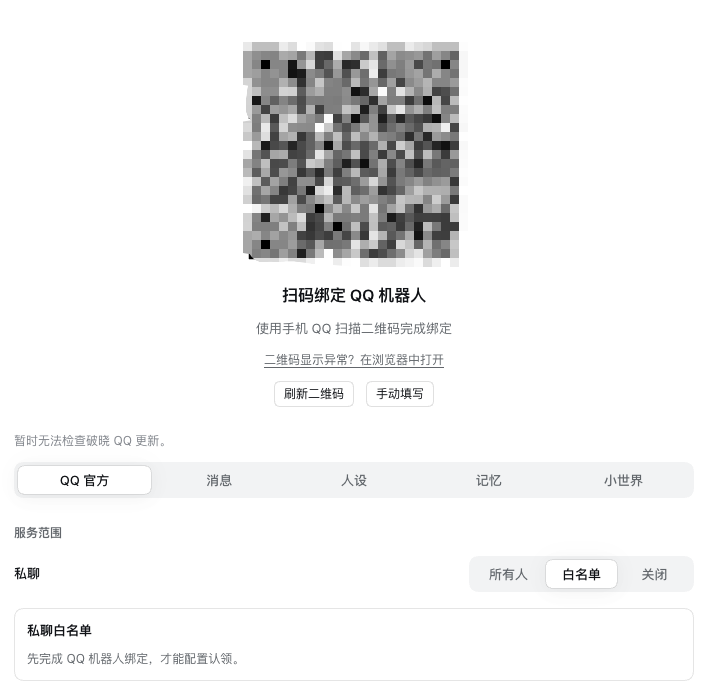

# 破晓 · QQ 角色助手

`dsh-poxiao-qqbot` 是破晓维护的 DeepSeek Harness（DSH）插件。绑定你自己的 QQ 机器人后，可以在 QQ 和角色聊天，也可以按需接入语音、Obsidian 记忆和小世界。

## 设置

| 页面 | 可以设置什么 |
| --- | --- |
| QQ 官方 | 绑定机器人，设置私聊、群聊和命令的访问范围。 |
| 消息 | 默认把同一个人 8 秒内连发的私聊合并成一轮。默认开启「主动来找我」，角色只会在已认领且允许私聊的主人会话里，有话想说时再联系。可选接入 BreezeBlue 语音和表情包。 |
| 人设 | 选择角色模板，调整称呼、性格和说话方式。 |
| 记忆 | 选择 Obsidian 库文件夹，设置旧事检索和记忆整理。首次使用可以从设置页进入 [Obsidian 官方下载页](https://obsidian.md/download)。 |
| 小世界 | 粘贴小世界服务的 MCP 连接 JSON，让角色使用该服务提供的工具。 |

## 上游与许可

QQ 连接、绑定和消息收发基于腾讯 QQ 开放平台维护的 [@tencent-connect/dsh-qqbot](https://github.com/tencent-connect/dsh-qqbot)。QQ 应用注册和接口规则见 [QQ 开放平台文档](https://bot.q.qq.com/wiki/)。

本项目采用 [MIT 许可证](./LICENSE)，保留上游版权声明。
